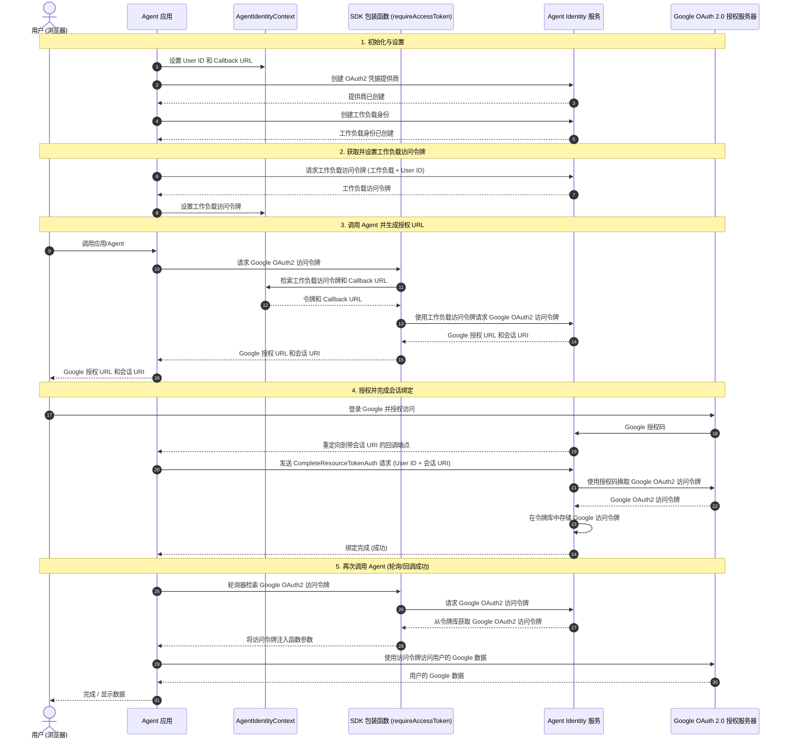
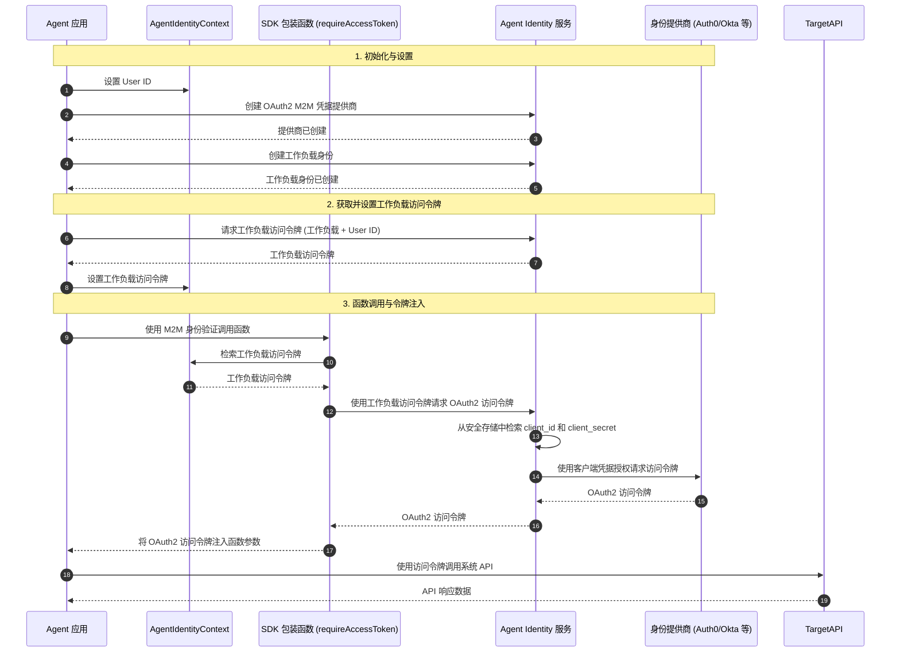
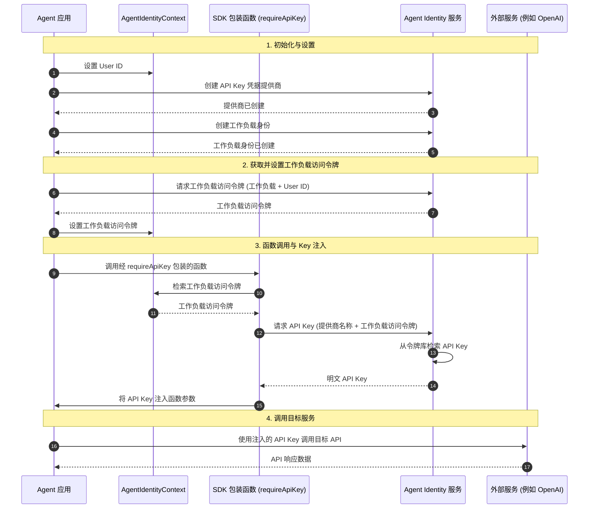
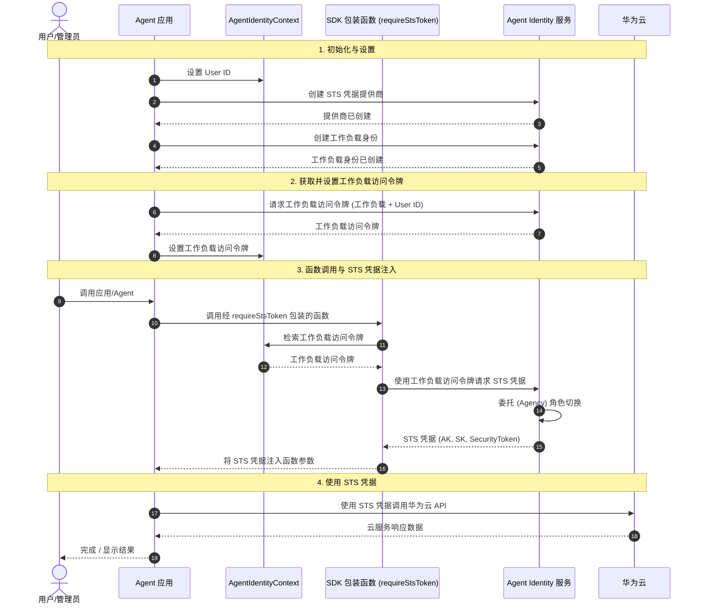

# Agent Identity Development SDK

一个旨在简化 AI Agent 的 OAuth2.0 和 API Key 管理的 TypeScript SDK。该 SDK 提供了易于使用的包装函数（替代 Python 装饰器）和高级客户端，用于处理凭据获取、会话绑定和令牌轮询。

## 特性

- **简化身份验证：** 使用包装函数自动将 OAuth2 令牌和 API Key 注入到你的函数中。
- **双重支持：** 无缝支持同步和异步函数。
- **会话绑定：** 支持 Agent 的"授权 URL 会话绑定"流程。
- **本地开发：** 通过 `.agent_identity.json` 自动处理本地身份配置。
- **灵活轮询：** 内置用户授权完成的轮询机制。

## 前提条件

在使用 OAuth2 流程之前，请确保你已配置：

1. **回调 URL**：对于 USER_FEDERATION 流程，请在你的身份提供商中配置重定向 URI。
2. **允许的资源 OAuth2 返回 URL (Allowed Resource OAuth2 Return URL)**：对于 USER_FEDERATION 流程，在华为云控制台的工作负载身份中白名单化该回调
   URL。
3. **Client ID 和 Client Secret**：由你的身份提供商（如 Auth0、Okta 等）颁发，并在华为云控制台中进行配置。

这些配置在**华为云控制台**的"**Agent Identity > 凭据提供商**"下进行管理。你的代码只需引用 `providerName`
，而服务将处理安全的凭据存储和令牌交换。

## 工作原理

SDK 支持多种身份验证流程，以适应不同的资源提供商。

### OAuth2 流程

下图展示了使用 Agent Identity SDK 的 OAuth2 流程：



### OAuth2 M2M (机器对机器) 流程

下图展示了使用 Agent Identity SDK 的 OAuth2 M2M（客户端凭据授权）流程：



### API Key 流程

下图展示了 API Key 获取流程：



### STS Token 流程

下图展示了 STS Token 获取流程（例如华为云 IAM）：



## 安装

使用 `pnpm` 安装 SDK：

```bash
pnpm add agentarts-sdk
```

或者使用 `npm`：

```bash
npm install agentarts-sdk
```

## 快速入门

### 1. 配置华为云 Union SDK

本 SDK 依赖于华为云 Union SDK。你必须配置以下环境变量以通过华为云服务进行身份验证：

```bash
export HUAWEICLOUD_SDK_AK="your-access-key"
export HUAWEICLOUD_SDK_SK="your-secret-key"
export HUAWEICLOUD_SDK_PROJECT_ID="your-project-id"
export HUAWEICLOUD_SDK_REGION="cn-north-4"
export HUAWEICLOUD_SDK_DOMAIN_ID="your-domain-id"
```

#### 自定义服务终端节点 (Endpoint)

您可以使用以下环境变量自定义各服务的终端节点：

| 环境变量 | 说明 | 默认值 |
|----------|------|--------|
| `HUAWEICLOUD_SDK_AGENTIDENTITY_ENDPOINT` | Agent Identity 服务端点 | `https://agent-identity.{region}.myhuaweicloud.com` |
| `HUAWEICLOUD_SDK_IAM_ENDPOINT` | IAM 服务端点 | `https://iam.{region}.myhuaweicloud.com` |

**配置示例：**

```bash
# 自定义 Agent Identity 服务端点
export HUAWEICLOUD_SDK_AGENTIDENTITY_ENDPOINT="https://agent-identity.cn-north-4.myhuaweicloud.com"

# 自定义 cn-southwest-301 区域的终端节点（特殊格式）
export HUAWEICLOUD_SDK_REGION_AGENTIDENTITY_CN_SOUTHWEST_301="https://agent-identity-open.cn-southwest-301.beta.myhuaweicloud.com"
```

> **Note:** 更多环境变量配置请参考 [环境变量配置指南](environment_variables.md)。

### 2. 使用包装函数

推荐使用包装函数来处理凭据生命周期。它们会自动将令牌或密钥注入到你的函数参数中。

Python 的 `@require_access_token` 等装饰器在 TypeScript 中改为**工厂函数**：
`requireAccessToken(options)` 返回一个包装函数，用它包住你的处理函数即可；被注入的令牌/密钥
会作为**最后一个位置参数**传入原函数。

```ts
import { requireAccessToken, requireApiKey, requireStsToken } from 'agentarts-sdk';
import type { StsCredentials } from 'agentarts-sdk/sdk/identity/types';

// OAuth2 Access Token 注入（异步）
const fetchGoogleData = requireAccessToken({
  providerName: 'google',
  scopes: ['https://www.googleapis.com/auth/userinfo.email'],
  authFlow: 'USER_FEDERATION',
})(async (accessToken: string) => {
  console.log(`Using OAuth2 token: ${accessToken}`);
});

// M2M Access Token 注入（异步）
const callInternalService = requireAccessToken({
  providerName: 'my-company-api',
  authFlow: 'M2M',
})(async (accessToken: string) => {
  console.log(`Using M2M OAuth2 token: ${accessToken}`);
});

// API Key 注入（同步）
const callLlm = requireApiKey({ providerName: 'openai' })(
  (apiKey: string) => {
    console.log(`Using API Key: ${apiKey}`);
  },
);

// STS Token 注入
const accessHuaweiResource = requireStsToken({
  providerName: 'huaweicloud-iam',
  agencySessionName: 'example-session',
})(async (stsCredentials: StsCredentials) => {
  // 直接访问 SDK 对象字段
  console.log(`AK: ${stsCredentials.accessKeyId}`);
  console.log(`SK: ${stsCredentials.secretAccessKey}`);
  console.log(`SecurityToken: ${stsCredentials.securityToken}`);
});

// 调用包装后的函数（注册到 Handler / 直接调用均可）
await fetchGoogleData();
await callInternalService();
callLlm();
await accessHuaweiResource();
```

如果业务函数还需要业务入参，注入值会追加到最后：

```ts
const secured = requireAccessToken({
  providerName: 'my-google-provider',
  authFlow: 'USER_FEDERATION',
  scopes: ['https://www.googleapis.com/auth/drive.readonly'],
})(async (payload: { fileId: string }, accessToken: string) =>
  callApi(payload, accessToken),
);

await secured({ fileId: 'abc' });
```

### 3. 使用 IdentityClient

使用 `IdentityClient` 进行手动控制，例如在 Web 回调中完成会话绑定。

```ts
import { IdentityClient } from 'agentarts-sdk';
import { UserIdentifier } from 'huaweicloud-sdk-agentidentity';

const client = new IdentityClient('cn-north-4');

// 手动获取令牌
const token = await client.getResourceOauth2Token({
  providerName: 'google',
  scopes: ['...'],
  workloadAccessToken: '...',
  authFlow: 'USER_FEDERATION',
});

// 手动获取 STS 凭据
const stsCredentials = await client.getResourceStsToken({
  providerName: 'huaweicloud-iam',
  workloadAccessToken: '...',
  agencySessionName: 'my-session',
});

// 完成会话绑定 (3LO 流程)
const userIdentifier = new UserIdentifier({ userId: 'user-123' });
await client.completeResourceTokenAuth('urn:uuid:...', userIdentifier);
```

### 4. 使用 AgentIdentityContext

`AgentIdentityContext`（在 Node.js 版中与 Runtime 共用的全局上下文）管理当前请求的执行上下文，
例如当前用户 ID 或回调 URL。

```ts
import { AgentArtsRuntimeContext } from 'agentarts-sdk';

// 在调用包装函数之前设置上下文
AgentArtsRuntimeContext.setUserId('user-123');
AgentArtsRuntimeContext.setOauth2CallbackUrl('https://yourapp.com/callback');
AgentArtsRuntimeContext.setOauth2CustomState('session-uuid-123');

// 从上下文中检索值
const currentUser = AgentArtsRuntimeContext.getUserId();
```

## 示例

查看仓库 `examples/` 目录以获取更多应用模板（LangGraph 等框架的接入方式）。
本文档中的代码片段可直接在 Node.js 20+ 环境运行：

```bash
# 以 TypeScript 直接运行（需 tsx）
npx tsx examples/agent-identity.ts
```

## 开发

### 设置

本项目采用 **pnpm workspace** 组织。要设置包含所有子包的开发环境：

```bash
# 克隆仓库
git clone <repository-url>
cd agentarts-sdk-js

# 安装工作区依赖
pnpm install

# 构建所有包
pnpm build
```

### 构建

```bash
# 构建所有 workspace 包（产物在各自 dist/ 目录）
pnpm build
```

### 运行测试

```bash
pnpm test

# 仅运行集成测试（需要云上凭据，默认跳过）
pnpm test:integration
```

### 格式化与 Lint

```bash
pnpm format
```

### 类型检查

```bash
pnpm typecheck
```

### 文档

文档以 Markdown 形式维护在 `docs/cn/` 目录，可直接在 IDE 或 Git 托管页面浏览。

## 项目结构

- `packages/agentarts-sdk/src/sdk/identity/`: 身份相关 SDK 源代码。
    - `auth.ts`: 身份上下文、客户端和包装函数实现。
    - `config.ts`: 本地身份配置加载。
    - `types.ts`: 身份相关类型定义。
- `packages/huaweicloud-sdk-agentidentity/`: Agent Identity 底座 SDK（对应 Python `huaweicloudsdkagentidentity`）。
- `tests/`: 完整的测试套件。
- `examples/`: 使用示例和模板。
